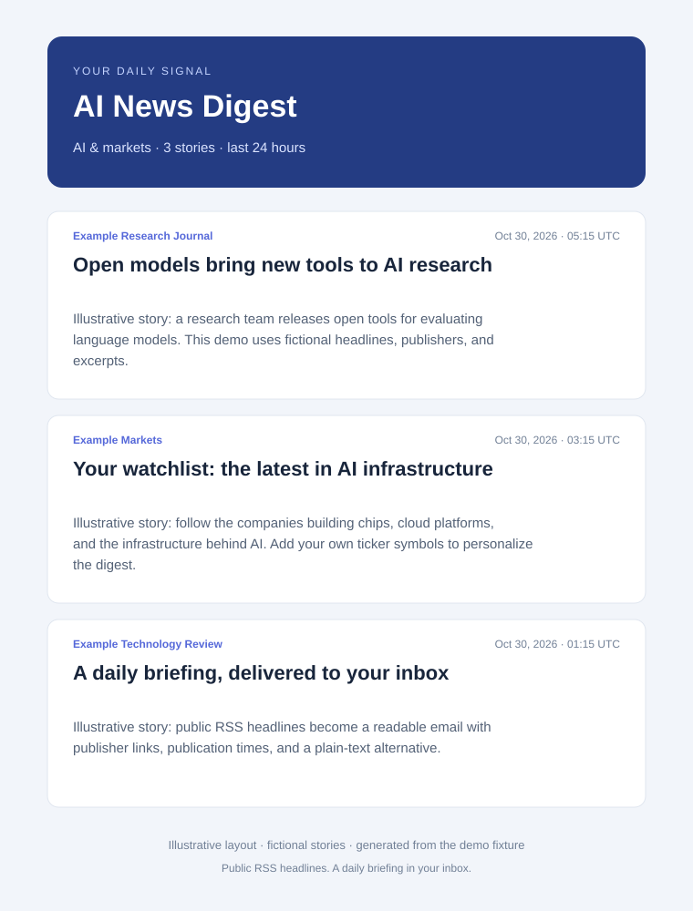
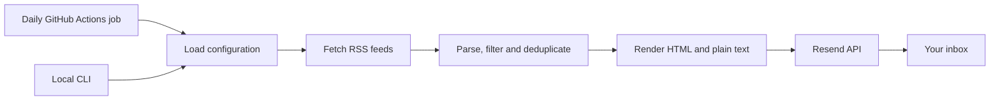

# AI News Digest

**A daily briefing for AI news and your stock watchlist, delivered to your inbox.**


A Python application that collects public RSS headlines, filters recent stories,
removes duplicate links, and sends an HTML and plain-text email through Resend.
GitHub Actions runs it daily in the cloud, even when your computer is off.



*Illustrative layout with fictional stories. The HTML sample uses the actual email template.
[Sample HTML](docs/sample-digest.html) · [Publishing guide](docs/PUBLISHING.md) ·
[Portfolio kit](docs/PORTFOLIO.md)*

## Features

- General AI headlines and an optional, configurable stock watchlist.
- RSS 2.0 and Atom parsing, UTC date normalization, and publication-window filtering.
- Exact-link deduplication, newest-first ordering, and a configurable story limit.
- Escaped feed content, validated HTTP links, and table-based HTML with inline styles.
- Transient-error retries, request timeouts, and idempotent email transport retries.
- Visible partial-feed warnings; total feed outages fail without sending an empty digest.
- Daily scheduling with a named time zone, manual preview/send controls, and CI.
- Zero third-party Python dependencies, databases, or always-on servers.

This project aggregates AI-related news. It does not use an LLM, generate
summaries, scrape articles, or make trading decisions. Titles and excerpts come
from RSS entries; Google News links redirect to the associated publisher stories.

## Architecture



Built with Python's standard library: `urllib` for HTTP, `ElementTree`
for XML, dataclasses for application data, and `unittest` for offline tests.

## Quick start

Requires **Python 3.12+**. Clone the repo and enter its directory.
No package installation is needed. On macOS/Linux, use `python3` if needed.

```bash
python --version
python -m unittest discover -s tests -v
python -m examples.generate_preview
```

Open `docs/sample-digest.html` for an offline demo with fictional stories.
For a live preview, internet access is required but email credentials are not:

```bash
python news_digest.py --dry-run --output preview.html
```

Open `preview.html`. Omit `--output` to print HTML to stdout; logs go to stderr.

To send, copy `.env.example` to `.env`, enter your settings, and run:

```bash
python news_digest.py
```

Use an authorized Resend sender. For production,
[verify a sender domain](https://resend.com/docs/dashboard/domains/introduction).
API acceptance is logged with an email ID; check Resend for final delivery status.

## Daily cloud setup

1. Push the source to your new GitHub repository's **default branch**.
2. In **Settings → Secrets and variables → Actions**, add these **repository secrets**:

   | Secret | Value |
   | --- | --- |
   | `RESEND_API_KEY` | Resend API key with email-sending permission |
   | `EMAIL_FROM` | e.g. `AI News Digest <digest@your-verified-domain.com>` |
   | `DIGEST_RECIPIENTS` | Your address, or comma-separated recipient addresses |

3. Optionally add **repository variables**:

   | Variable | Default | Example |
   | --- | --- | --- |
   | `WATCHLIST` | Empty: AI news only | `NBIS,NVDA,AMD,PLTR` |
   | `MAX_ARTICLES` | `30` | `20` |

4. Open **Actions → Daily news digest → Run workflow**. Keep **dry_run** checked
   for a preview in the logs. Run again with **dry_run unchecked** to send a test.
5. Check your inbox and Resend delivery logs.

The workflow runs at **08:15 Europe/Athens daily**, including daylight-saving
adjustments, with a **24-hour lookback**. Your computer can be powered off.
Change `cron` and `timezone` in [digest.yml](.github/workflows/digest.yml)
to change the time. Disable old local schedules to avoid additional digests.
**CI never sends email.**

GitHub schedules run from the default branch and can be delayed or missed.
Public-repository schedules disable after 60 days without repository activity.
Review Actions runs and configure GitHub workflow-failure notifications.
[GitHub scheduling docs](https://docs.github.com/en/actions/reference/workflows-and-actions/events-that-trigger-workflows#schedule).

## Configuration

Environment variables override `.env`. The file is read next to the script,
independently of the working directory. The loader supports basic `KEY=value`
entries and matching quotes, without shell expansion or inline-comment parsing.

| Variable | Default | Accepted values |
| --- | --- | --- |
| `RESEND_API_KEY` | Unset | Required for sending; keep secret |
| `EMAIL_FROM` | Unset | Sender address, optionally with a display name |
| `DIGEST_RECIPIENTS` | Unset | 1–50 comma-separated addresses; recipients see the To list |
| `WATCHLIST` | Empty | Up to 20 ticker symbols; empty means AI only |
| `LOOKBACK_HOURS` | `24` | Integer, 1–168 |
| `MAX_ARTICLES` | `30` | Integer, 1–100 |
| `REQUEST_TIMEOUT` | `20` | Per-network-operation timeout in seconds, 1–60 |
| `MAX_ATTEMPTS` | `3` | Total attempts per request, 1–5 |

The daily workflow fixes `LOOKBACK_HOURS=24`; edit its environment block for
another frequency. Local `.env` settings are not uploaded to GitHub.
Personal ticker choices live in configuration, not application defaults.

## Reliability and limitations

- Transient network errors and HTTP 408, 429, 500, 502, 503, and 504 are retried.
  Backoff respects `Retry-After` up to 60 seconds.
- Feed responses are limited to 5 MiB. Invalid XML and non-feed responses count
  as failures. Invalid dates and future-dated stories are excluded.
- Partial coverage is labeled in the email. Total feed failure exits with
  status 1. Successfully read feeds with no recent stories are a valid empty result.
- Identical payloads use the same [Resend idempotency key](https://resend.com/docs/dashboard/emails/idempotency-keys)
  for safe transport retries within its 24-hour retention window. Separate runs
  with different content can send additional emails.
- Deduplication is per run. There is no persistent history or delivery watermark.
  Scheduling delays and daylight-saving transitions can create gaps or overlap
  in the rolling 24-hour window.
- RSS coverage is best effort. The article limit keeps emails manageable, but
  high limits or unusually long links can still cause email-client clipping.
- The cloud job has a 10-minute timeout. Large watchlists or slow feeds may
  require shorter request timeouts, fewer attempts, or a longer job budget.

Vercel is not needed for this CLI application. A protected HTTP handler and
cron route would be needed to run it as a Vercel Function.
[Local scheduling alternatives](SCHEDULING_OPTIONS.md).

## Development

```bash
python -m unittest discover -s tests -v
python -m examples.generate_preview --check
python -m tools.export_source
```

Tests cover configuration, RSS/Atom parsing, date boundaries, deduplication,
outages, retries, email payloads, escaping, and the CLI using mocked HTTP.
The export command creates an ignored source ZIP under `exports/`, without
local credentials or Git history.
[CI](.github/workflows/ci.yml) is configured for Python 3.12–3.14 on Linux and
Python 3.12 on Windows/macOS. Actions are pinned to commit SHAs; Dependabot
checks for workflow updates monthly.

```text
.github/                 Daily workflow, CI, and Dependabot configuration
news_digest.py           Feed pipeline, renderer, Resend client, and CLI
tests/                   Offline regression suite
examples/                Reproducible fictional demo
docs/                    Preview, publishing guide, and portfolio kit
tools/export_source.py   Source ZIP without secrets or existing Git history
schedule.ps1             Optional Windows schedule
schedule_macos.sh        Optional macOS schedule
```

## Publishing and portfolio

[Publishing guide](docs/PUBLISHING.md) · [Portfolio kit](docs/PORTFOLIO.md) ·
[MIT license](LICENSE)

News content remains the property of its publishers. The MIT license applies
to this project's code.
